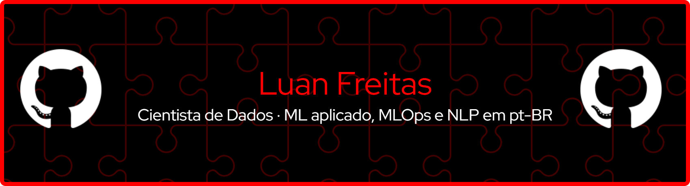
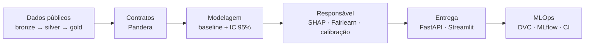

  

 <!-- https://leviarista.github.io/github-profile-header-generator/ -->

<h1 align="center">Luan Freitas</h1>

  <strong>Cientista de Dados · ML aplicado, MLOps e NLP em pt-BR</strong> 
  IA Responsável com rigor estatístico e engenharia de software 
  Bacharel em Ciência da Computação — Universidade de Brasília (UnB)

  11 projetos ponta a ponta · resultados com baseline, IC 95% quando aplicável e limitações declaradas (⚠️) · 48 skills open source para Claude Code

  
  
  
  
  
  

  <a href="#-projetos-em-destaque">Projetos</a> ·
  <a href="#-pesquisa-acadêmica--tcc">Pesquisa</a> ·
  <a href="#-como-eu-trabalho">Como trabalho</a> ·
  <a href="#️-stack-técnica">Stack</a> ·
  <a href="#-vamos-conversar">Contato</a> ·
  <a href="README.en.md">🇺🇸 English</a>

---

## 👋 Sobre mim

Construo **sistemas de machine learning que sobrevivem fora do notebook**: pipelines reprodutíveis,
contratos de dados validados, métricas honestas com intervalo de confiança e modelos servidos via API
ou dashboard. Meu foco está na interseção entre **rigor científico e engenharia de software**.

- 🔭 Trabalhando em um **portfólio de projetos ponta a ponta** em ML aplicado, MLOps e NLP em português
- 🌱 Aprofundando em **IA Generativa (LLMs locais e RAG)** e **Computação em Nuvem**
- 🧠 Interesses: **IA Responsável** — explicabilidade (SHAP), calibração de probabilidades e auditoria de fairness
- 🎯 Buscando oportunidades em **Ciência de Dados, Engenharia de ML e IA Aplicada** (saúde, finanças, educação e pesquisa aplicada)
- 📫 Melhor forma de falar comigo: [LinkedIn](https://www.linkedin.com/in/luanfreitas5/)

---

### 🧰 Ferramentas

| Projeto | O que é | Stack principal |
|---|---|---|
| **[🧪 ds-skills](https://github.com/luanfreitas5/ds-skills)** | Coleção de 48 *skills* para Claude Code que levam agentes de IA ao padrão de um cientista de dados sênior: avaliação estatisticamente correta, dados validados, reprodutibilidade e IA responsável (LGPD, fairness) | `Claude Code` `Python` `Markdown` |

## 🚀 Projetos em destaque

Cinco projetos que cobrem pilares diferentes do ciclo de vida de ML — MLOps, explicabilidade,
fairness, benchmark científico e séries temporais. Os demais ficam em [Mais projetos](#mais-projetos).

| Projeto | Problema | Resultado-chave | Stack principal |
|---|---|---|---|
| **[🛡️ Detecção de Fraude com Pipeline MLOps Completo](https://github.com/luanfreitas5/mlops-deteccao-fraude)** | Fraude em ~284k transações com desbalanceamento extremo (~0,17%) | 🟢 PR-AUC `0,815` (IC 95% `0,732`–`0,892`) · Recall `81,1%` no limiar de custo mínimo — ⚠️ baseline ainda não medido | `XGBoost` `DVC` `MLflow` `FastAPI` `Docker` `GitHub Actions` |
| **[🔮 Previsão de Churn com Explicabilidade (Olist)](https://github.com/luanfreitas5/previsao-churn-explicavel)** | Identificar clientes com risco de não recomprar no marketplace Olist | 🟢 ROC-AUC `0,62` · Brier `0,0720` · PR-AUC `0,9919` (IC 95% `0,9897`–`0,9939`) vs. `0,9882` do baseline — ⚠️ prevalência de 98,8% infla a PR-AUC; sem teste de significância | `Polars` `LightGBM` `SHAP` `Fairlearn` `MLflow` `Streamlit` |
| **[⚖️ Predição de Risco de Diabetes com Auditoria de Justiça](https://github.com/luanfreitas5/risco-diabetes-fairness)** | Triagem de risco de diabetes a partir do BRFSS 2015 (~253k respostas) | 🟢 ROC-AUC `0,8314` (IC 95% `0,8293`–`0,8335`, CV) vs. `0,8240` da regressão logística · maior disparidade de recall (escolaridade) `51 p.p.` | `LightGBM` `Fairlearn` `SHAP` `Streamlit` `Plotly` |
| **[📊 Benchmark de Análise de Sentimento em PT-BR](https://github.com/luanfreitas5/sentimento-ptbr-benchmark)** | BERTimbau realmente supera baselines clássicos? E generaliza entre domínios? | 🟢 F1-macro in-domain `0,890` (BERTimbau) vs. `0,843` (TF-IDF) · fora do domínio `0,796` vs. `0,722` — ⚠️ McNemar ainda não gerado | `BERTimbau` `Transformers` `scikit-learn` `MLflow` `uv` |
| **[📉 Previsão do IPCA com Backtest Walk-Forward](https://github.com/luanfreitas5/previsao-ipca-backtest)** | Algum modelo, usando só informação disponível na data, supera o Boletim Focus na previsão do IPCA mensal? | 🟢 Nenhum modelo superou o Focus: RMSE `0,257` (IC 95% `0,220`–`0,293`) vs. `0,334` do melhor modelo (AutoARIMA) em 1 mês (Diebold-Mariano p < 0,001); empate estatístico em 6 e 12 meses | `statsforecast` `LightGBM` `MLflow` `Pandera` |

### Mais projetos

| Projeto | Problema | Resultado principal | Stack principal |
|---|---|---|---|
| **[🤖 Análise de Emoção e Tópicos em Tweets com LLM Local](https://github.com/luanfreitas5/tweets-emocao-llm-local)** | Emoção e tópicos em ~800k tweets em português | 🟢 F1-macro `0,362` (IC 95% `0,361`–`0,363`; baseline trivial `0,266`) · meta de `0,70` não atingida · `31` tópicos, porém modelagem degenerada (37,9% outliers) · tweets/s não medido | `BERTopic` `Ollama` `Llama 3.1` `FastAPI` `Pydantic` |
| **[📈 Simulador do Tesouro Direto](https://github.com/luanfreitas5/simulador-tesouro-direto)** | Quanto sobra ao investidor após imposto, custódia e inflação? Curva de juros histórica e rentabilidade bruta, líquida e real | 🟢 Pipeline em ~5 s sobre `177.434` preços (2004–2026) com contratos Pandera aprovados · curva Prefixada **invertida** em 15/10/2026 (`13,37%` em 0,2 ano vs. `12,64%` em 2,2 anos) e IPCA+ plana (`6,7%`–`6,8%` real) · simulador bruto/líquido/real vs. Selic | `Polars` `Pandera` `uv` `GitHub Actions` `MkDocs` |
| **[🏛️ Mapa Temático do Congresso](https://github.com/luanfreitas5/mapa-tematico-congresso-nlp)** | Quais temas dominam a Câmara dos Deputados (57ª legislatura) e quem são os atores centrais nas redes de coautoria e de votos? | 🟢 Coerência c_v `0,739` (IC 95% `0,702`–`0,774`) em `17.482` ementas (`122` tópicos, 25,3% de ruído) e `0,666` em `44.269` discursos (`125` tópicos, 54,1% de ruído) · rede de coautoria com `617` deputados e `9.230` arestas · rede de votos com `22` partidos em `2` comunidades | `BERTopic` `sentence-transformers` `NetworkX` `Pandera` |
| **[🎓 Radar da Educação Municipal](https://github.com/luanfreitas5/radar-educacao-municipal)** | Que tipologias de município emergem de infraestrutura escolar e contexto socioeconômico? O IDEB se agrupa no território? | 🟢 `4` tipologias estáveis (ARI `0,98`, IC 95% `0,95`–`0,99`; ⚠️ silhouette baixa, `0,189`) · IDEB difere entre grupos (Kruskal-Wallis, ε² `0,24` anos iniciais / `0,19` finais) · autocorrelação espacial forte (I de Moran `0,625` / `0,591`) | `scikit-learn` `UMAP` `geobr` `Polars` |
| **[🎯 Desempenho no ENEM e Equidade](https://github.com/luanfreitas5/desempenho-enem-equidade)** | Quanto o perfil socioeconômico explica a nota do ENEM, e o erro do modelo é equânime entre grupos? | 🟢 R² `0,330` (IC 95% `0,325`–`0,335`) com XGBoost vs. `0,319` do OLS (RMSE `70,98`) · perfil socioeconômico explica só ~33% da variância · renda e computador dominam o SHAP · gap de renda (até 1 SM vs. mais de 6 SM) `−128,9` pontos · modelo superestima indígenas (`+32,5`) e escola pública (`+15,0`) | `Polars` `XGBoost` `SHAP` `Fairlearn` |
| **[💹 Painel Macro BCB](https://github.com/luanfreitas5/painel-macro-bcb)** | O quanto a mediana do Focus erra o IPCA mensal, e há viés sistemático por horizonte? | 🟢 MAE do Focus cresce de `0,082` p.p. (mês corrente) para `0,265` p.p. (12 meses) e satura · viés levemente negativo (`−0,088` p.p. em 12 meses, IC exclui zero) · ⚠️ ICs ignoram autocorrelação dos erros | `Streamlit` `Polars` `python-bcb` `uv` |

Projeto 🟢 completo, 🟡 parcial, 🔴 pendente.

---

## 🎓 Pesquisa acadêmica — TCC

### [UnBSense](https://github.com/luanfreitas5/UnBSense) — Desenvolvimento de Ferramenta de Análise de Sentimentos para Identificação de Possíveis Sinais de Comportamento Depressivo na Rede Social Twitter

DOI: [10.5753/reic.2024.3430](https://doi.org/10.5753/reic.2024.3430)

> **Trabalho de Conclusão de Curso** — Bacharelado em Ciência da Computação, Universidade de Brasília (UnB)
> Inclui a [monografia completa](https://github.com/luanfreitas5/UnBSense/blob/main/Monografia_TCC.pdf) e o [artigo PIBIC](https://github.com/luanfreitas5/UnBSense/blob/main/Artigo%20PIBIC.pdf) no repositório.

Estudo de mineração de dados sobre usuários brasileiros do Twitter para detectar **sinais
comportamentais associados à depressão**, comparando dois recortes temporais: **pré-pandemia
(2018–2019)** e **pandemia (2020–2021)**.

**Contribuição.** Além dos **10 atributos comportamentais** consolidados na literatura (De Choudhury et al.),
o trabalho propõe e avalia **5 novos atributos** (caracteres orientais, emojis, links, mídia e curtidas). Cada atributo é sumarizado em **4 vetores de
características** — média, variância, média móvel ponderada e entropia — totalizando **60 features por
dataset**.

**Metodologia.** Pipeline completo de coleta (`tweepy`, `snscrape`), pré-processamento e NLP (`NLTK`,
`spaCy`), seleção de features e seleção de modelos, avaliando um amplo conjunto de classificadores
supervisionados: **Random Forest, Gradient Boosting, SVM (RBF), MLP, AdaBoost, Bagging, KNN, LDA,
Naive Bayes, Regressão Logística e ensembles por votação** (hard/soft), com tratamento de
desbalanceamento via `class_weight` e avaliação por curvas ROC e Precision-Recall.

> **🟢 Resultados** (teste, 70/15/15 por usuário; detalhes e limitações no [README do UnBSense](https://github.com/luanfreitas5/UnBSense#-resultados))
>
> - Base: `71.232` usuários na pré-pandemia (`37.985` depressão / `33.247` controle) e `70.370` na pandemia (`36.801` / `33.569`), rotulados por autodeclaração pública
> - Melhor classificador: **Gradient Boosting** — F1 `81,6%` (pré-pandemia) e `79,9%` (pandemia), média `80,75%`; baseline de Regressão Logística em `73,7%` / `74,9%` (validação)
> - Os **5 novos atributos não melhoraram** o modelo: ΔF1 ≤ `0,4` p.p. sobre os 10 atributos de De Choudhury, e por isso foram removidos do teste final
> - Pandemia: sem evidência estatística de aumento de depressão atribuível à COVID-19 (sem controle de variáveis de confusão)
> - ⚠️ F1 de ponto único, sem IC nem teste de significância · `39–43%` dos controles classificados como depressivos · rótulo é autodeclaração, não diagnóstico · possível vazamento de rótulo a verificar

`Python` · `scikit-learn` · `pandas` · `NLTK` · `spaCy` · `snscrape` · `Jupyter`

---

## 🧭 Como eu trabalho

Padrões de engenharia que aplico de forma consistente em todos os projetos acima:

| Princípio | Na prática | Veja |
|---|---|---|
| **Métrica honesta** | PR-AUC / F1-macro com **IC 95% por bootstrap** — nunca acurácia em dado desbalanceado | [reports/metrics](https://github.com/luanfreitas5/risco-diabetes-fairness/tree/main/reports/metrics) |
| **Sem vazamento** | Features construídas apenas com informação disponível no momento da predição; reamostragem dentro do pipeline | [src/backtest](https://github.com/luanfreitas5/previsao-ipca-backtest/tree/main/src/backtest) |
| **Contratos de dados** | `Pandera` e `Pydantic` validando schema nas fronteiras do pipeline e da API | [src/schemas](https://github.com/luanfreitas5/mlops-deteccao-fraude/tree/main/src/schemas) |
| **Probabilidade confiável** | Calibração explícita e **Brier score**, não apenas ranqueamento | [src/evaluation](https://github.com/luanfreitas5/previsao-churn-explicavel/tree/main/src/evaluation) |
| **Explicabilidade** | **SHAP** traduzido para linguagem de negócio, não gráfico decorativo | [src/explainability](https://github.com/luanfreitas5/previsao-churn-explicavel/tree/main/src/explainability) |
| **IA Responsável** | Auditoria de fairness por subgrupo (`Fairlearn`), Model Cards e Datasheets | [reports/model_cards](https://github.com/luanfreitas5/risco-diabetes-fairness/tree/main/reports/model_cards) |
| **Reprodutibilidade** | Sementes fixas, lock files, hashes de dataset, versionamento com **DVC** e rastreio no **MLflow** | [dvc.yaml](https://github.com/luanfreitas5/mlops-deteccao-fraude/blob/main/dvc.yaml) |
| **Qualidade de código** | `pytest` com **≥80% de cobertura**, `ruff`, `basedPyright`, `pre-commit` e CI no GitHub Actions | [.github/workflows](https://github.com/luanfreitas5/mlops-deteccao-fraude/tree/main/.github/workflows) |
| **Entregável real** | A maioria dos projetos termina em **API (FastAPI)** ou **dashboard (Streamlit)**; os demais, em relatório reprodutível | [src/inference](https://github.com/luanfreitas5/mlops-deteccao-fraude/tree/main/src/inference) |

---

## 🛠️ Stack técnica

### Em produção nos meus projetos
| Área | Ferramentas | Onde usei |
|---|---|---|
| Dados | Polars · Pandera · DVC | [simulador-tesouro-direto](https://github.com/luanfreitas5/simulador-tesouro-direto), [mlops-deteccao-fraude](https://github.com/luanfreitas5/mlops-deteccao-fraude) |
| Modelagem | LightGBM · XGBoost · scikit-learn · statsforecast | [previsao-ipca-backtest](https://github.com/luanfreitas5/previsao-ipca-backtest) |
| NLP / LLM | BERTimbau · BERTopic · Ollama | [sentimento-ptbr-benchmark](https://github.com/luanfreitas5/sentimento-ptbr-benchmark) |
| MLOps | MLflow · FastAPI · Docker · GitHub Actions | [mlops-deteccao-fraude](https://github.com/luanfreitas5/mlops-deteccao-fraude) |
| IA responsável | SHAP · Fairlearn | [risco-diabetes-fairness](https://github.com/luanfreitas5/risco-diabetes-fairness) |

<!-- Também já usei: Java, C/C++, Spark, TensorFlow. Sem projeto público de destaque no momento.  -->

<picture>
  <source media="(prefers-color-scheme: dark)"  srcset="https://skillicons.dev/icons?i=py,fastapi,docker,githubactions&theme=dark">
  <source media="(prefers-color-scheme: light)" srcset="https://skillicons.dev/icons?i=py,fastapi,docker,githubactions&theme=light">
  
</picture>

<!-- Para simpleicons, passe a cor clara no tema escuro: -->
<!-- https://cdn.simpleicons.org/ollama/ffffff  (dark)  ·  https://cdn.simpleicons.org/ollama/111111  (light) -->

---

## 📈 Atividade no GitHub

  
  

<picture>
  <source media="(prefers-color-scheme: dark)" srcset="https://raw.githubusercontent.com/luanfreitas5/luanfreitas5/output/pacman-contribution-graph-dark.svg">
  <source media="(prefers-color-scheme: light)" srcset="https://raw.githubusercontent.com/luanfreitas5/luanfreitas5/output/pacman-contribution-graph.svg">
  
</picture>

---

## 📫 Vamos conversar

Aberto a oportunidades e colaborações em **Ciência de Dados**, **Engenharia de Machine Learning**
e **IA Aplicada**. O melhor caminho é o [LinkedIn](https://www.linkedin.com/in/luanfreitas5/).
